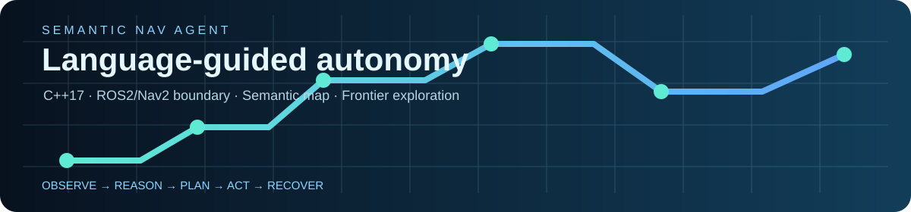
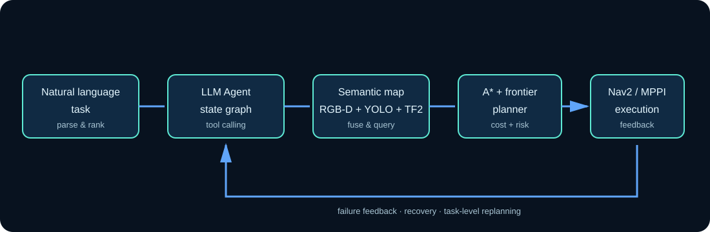
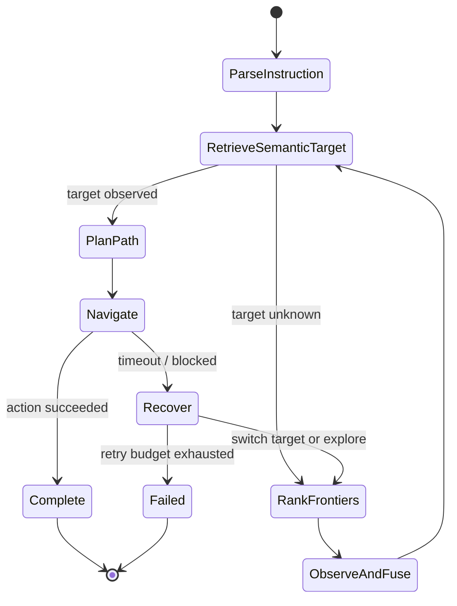
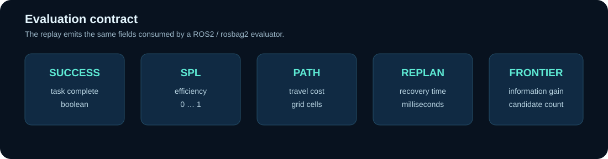

<p align="center">
  
</p>

<p align="center">
  <a href="https://github.com/Griszhou/semantic-nav-agent/actions"></a>
  
  
  
</p>

<p align="center"><b>基于 LLM Agent 与语义地图的移动机器人自主导航系统</b></p>
<p align="center">把自然语言任务转换成「理解目标 → 语义检索 → 主动探索 → A* 规划 → Nav2 执行 → 任务级恢复」的可观测闭环。</p>

> 这是一个可运行的工程原型。仓库内的 deterministic replay 不依赖 GPU、ROS2 或在线 LLM，便于面试官一键编译验证；ROS2/Nav2/Gazebo/LangGraph/YOLO/OpenCV 的接入边界以 adapter 和文档形式保留。README 中不把 replay 数字当作真实机器人实验结论。

## 30 秒运行

```bash
cmake -S . -B build
cmake --build build --config Release
ctest --test-dir build -C Release --output-on-failure
./build/Release/nav_demo "Find the red chair and then the blue box"
```

Windows 使用 `build\\Release\\nav_demo.exe`；Linux/macOS 使用 `build/nav_demo`。示例会打印 Agent 状态轨迹和 JSON 指标：

```text
[succeeded] navigate -> red chair (Nav2 action adapter completed)
[succeeded] navigate -> blue box (Nav2 action adapter completed)
metrics: {"success":true,"path_length":12.000,"spl":1.000,...}
```

## 系统结构

<p align="center"></p>

| 层 | 代码落点 | 作用 |
| --- | --- | --- |
| Task Agent | `include/semantic_nav/task_agent.hpp` | LangGraph 风格状态流：解析目标、检索、探索、规划、执行、恢复 |
| Semantic Map | `semantic_map.*` | RGB-D 深度反投影、TF2 坐标变换后的目标融合；维护几何栅格与对象索引 |
| Exploration | `exploration.*` | Frontier 候选评分：信息增益、语义相关性、路径代价、风险 |
| Planner | `planner.*` | 在占据栅格上运行 A*，输出全局路径和代价 |
| Execution boundary | `ros2/semantic_nav_bringup/` | ROS2 Action/Nav2、Gazebo、MPPI 的集成契约和参数模板 |
| Evaluation | `metrics.*` | success、路径长度、SPL、探索次数、重规划耗时的统一输出 |

## 任务状态图



## 可视化评测面板

<p align="center"></p>

指标接口与真实机器人数据解耦：将 ROS2 bag 或 SWE-bench 风格的任务回放转换为统一 JSON 后，即可替换 `nav_demo` 的 deterministic fixture。推荐记录 `success_rate`、`SPL`、`path_length`、`replan_latency_ms` 和 `frontier_gain`，而不是只看最终是否到达。

## 目录

```text
include/semantic_nav/       C++ 公共接口
src/                         语义地图、A*、探索、Agent、指标实现
apps/nav_demo.cpp            可执行的离线闭环演示
tests/test_core.cpp          CTest 核心回归测试
ros2/semantic_nav_bringup/   ROS2/Nav2/Gazebo 接入契约与参数模板
docs/                        架构、评测、简历项目描述
```

## ROS2 接入路线

1. `SemanticMap` 对接 `sensor_msgs/Image`、`CameraInfo` 和 `tf2_ros::Buffer`，将 YOLO/OpenCV 检测反投影到 `map` 坐标系。
2. `TaskAgent` 对接 LangGraph 或自建 LLM tool-calling adapter；工具只暴露语义检索、候选排序和 Nav2 Action，不允许模型直接写地图或执行 shell。
3. `AStarPlanner` 输出全局路径，Nav2 MPPI Controller 负责局部轨迹跟踪；`NavigateToPose` 的 feedback 驱动恢复状态。
4. Gazebo 场景通过 `ros2/semantic_nav_bringup/launch/sim.launch.py` 接入，评测器消费 rosbag2 和任务清单。

## 设计取舍

- **先可验证再接大依赖：** C++ 核心只依赖标准库，CI 能在干净 runner 上编译；ROS2 依赖集中在 bringup 层。
- **模型只做决策：** LLM 负责目标分解和候选选择，几何规划、路径校验和执行反馈由确定性模块完成。
- **失败可恢复：** 每个状态都有结构化 trace，导航失败可以切换候选目标或回到 frontier 探索，而不是静默重试。
- **结果可审计：** 每次运行输出 JSON 指标和动作轨迹，便于接 Prometheus、rosbag 或离线评测。

更多说明见 [架构设计](docs/architecture.md)、[评测协议](docs/evaluation.md) 和 [简历项目描述](docs/resume.md)。

## 免责声明

仓库用于展示系统设计与工程实现，默认 demo 是小型确定性地图回放。正式 ROS2/Gazebo 实验、真实 YOLO 权重和大模型效果需要在对应硬件、模型和场景下单独测量。

